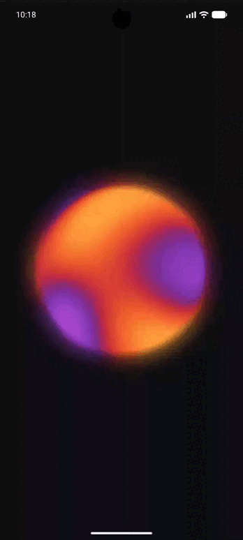
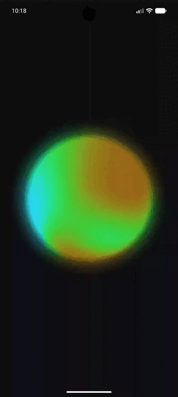
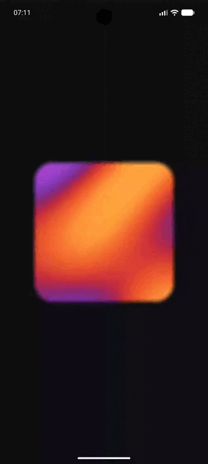
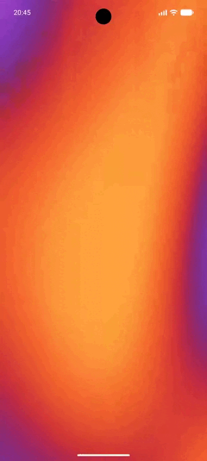
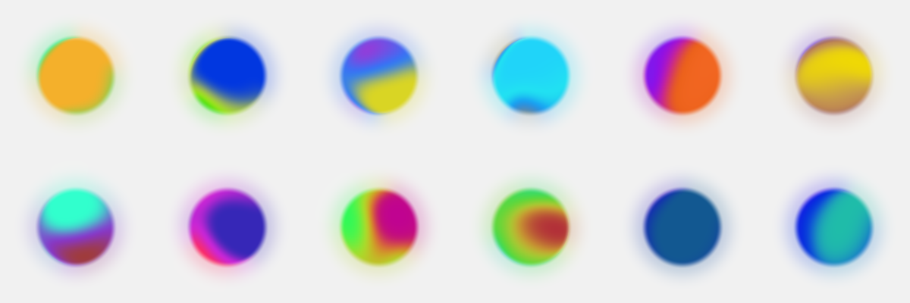
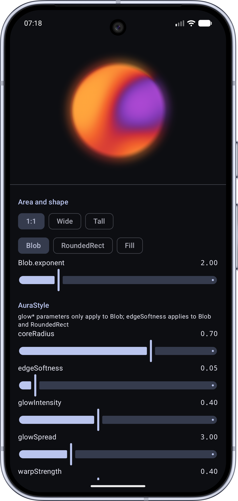
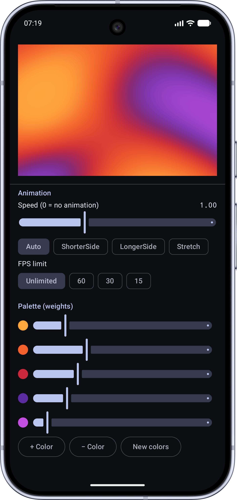

# Aura

Soft, animated "aura" for Jetpack Compose: a glowing sphere, a rounded card or a full-screen background, drawn by a single AGSL shader. You pass colors (optionally with shares of the area), pick a shape, and the library does the rest.


<!-- After the first release, uncomment: -->
<!-- [](https://central.sonatype.com/artifact/io.github.pearwhite-mb/aura) -->

## Demo

<p align="center">
  
  
  
  
</p>

<p align="center">
  <em>Blob · Random Blob · Rounded Rectangle · Fill</em>
</p>

[Features](#features) · [Installation](#installation) · [Quick start](#quick-start) · [Palettes](#palettes-and-color-shares) · [Shapes](#shapes) · [Animation](#animation) · [Style](#style-reference) · [Performance](#performance) · [Limitations](#limitations)

## Features

- **Any colors, up to 8**, in any order. Pass a plain list or give every color a weight: the weight is the share of the area the color should occupy.
- **Three shapes**: a sphere with a soft halo (`Blob`), a rounded rectangle with feathered edges (`RoundedRect`), and a fill for the whole area (`Fill`). Any other Compose shape works through `Modifier.clip`.
- **Spherical look**: the pattern wraps around the sphere, and the halo takes the color of the nearest edge.
- **Smooth palette changes**: new colors and new shares fade in; an interrupted transition continues from what is on screen.
- **Careful with resources**: no recompositions during animation (state is read in the draw phase), the per-frame work is designed to avoid allocations, the animation pauses when the screen is not visible, there is an optional frame rate limit, and the system "animation scale = off" setting is respected.
- **Graceful fallback** on Android 8-12: a gradient built from the same palette, or your own composable.
- **Deterministic**: the same `seed` always gives the same arrangement of spots.

## Requirements

| | |
|---|---|
| minSdk | 26 |
| Shader (AGSL) | Android 13 (API 33) and above |
| Android 8-12 | a gradient fallback is shown, or your own `fallback` content |
| Built and tested with | Kotlin 2.4.21, AGP 9.4.1, Compose BOM 2026.09.00, compileSdk 37 |

## Installation

The library is published on Maven Central.

```kotlin
// build.gradle.kts of your module
dependencies {
    implementation("io.github.pearwhite-mb:aura:0.1.0")
}
```

Or with a version catalog:

```toml
# gradle/libs.versions.toml
[libraries]
aura = { group = "io.github.pearwhite-mb", name = "aura", version = "0.1.0" }
```

```kotlin
implementation(libs.aura)
```

Make sure `mavenCentral()` is among your repositories (it is by default in new projects). All public API lives in the `io.github.pearwhitemb.aura` package.

## Quick start

```kotlin
@Composable
fun Hero() {
    Aura(
        palette = AuraDefaults.Palette,
        modifier = Modifier.size(300.dp),
    )
}
```

That is a sphere in the default style, flowing slowly. The aura is drawn **behind** the content of the node you give it the modifier for, and it takes exactly the size you set.

## Palettes and color shares

```kotlin
// Equal shares
AuraPalette.of(listOf(Color(0xFFFF7A18), Color(0xFFAF002D), Color(0xFF319197)))

// 70% orange, 30% purple
AuraPalette.weighted(
    Color(0xFFFF7A18) to 0.7f,
    Color(0xFF7B2FF7) to 0.3f,
)
```

- **Weights are proportions.** They do not need to sum to 1, so counts can be passed directly. Negative and non-finite weights count as 0; if all weights are 0, the shares are equal.
- **A weight of 0 is kept on purpose.** The color is invisible, and it grows smoothly from nothing when its weight becomes positive.
- **Order matters.** Neighbouring colors blend into each other, so put similar hues next to each other. Unrelated hues side by side can blend into muddy mixes.
- Only the first 8 colors are used (`AuraDefaults.MaxColors`).
- Palettes are compared by content, so passing an equal palette again does not restart a transition.

### Generating colors

```kotlin
AuraDefaults.vibrantPalette(count = 4)    // independent random bright colors
AuraDefaults.harmonicPalette(count = 4)   // colors along an arc of hues, darkening towards the end
```

`vibrantPalette` never produces dark tones (brightness is at least 0.85). `harmonicPalette` usually blends more cleanly. Both accept a `Random`, so results can be reproduced.

<p align="center">
  
</p>

### Driving the aura with data

```kotlin
enum class Mood(val color: Color) {
    Calm(Color(0xFF4FC3F7)), Joy(Color(0xFFFFB300)), Anxious(Color(0xFF8E24AA))
}

@Composable
fun MoodAura(counts: Map<Mood, Int>, modifier: Modifier = Modifier) {
    val palette = remember(counts) {
        // Keep the category order fixed: transitions match colors by index.
        AuraPalette.weighted(Mood.entries.map { it.color to (counts[it] ?: 0).toFloat() })
    }
    Aura(palette, modifier)
}
```

When `counts` changes, the colors and shares cross-fade (`colorTransition`, 800 ms by default; pass `null` to switch instantly).

## Shapes

```kotlin
// Sphere (default). exponent = 2 is a circle; larger values give a squircle.
Aura(palette, shape = AuraShape.Blob(exponent = 2f))

// Card with rounded corners and feathered edges.
Aura(palette, Modifier.fillMaxWidth().height(200.dp), shape = AuraShape.RoundedRect(cornerRadius = 0.3f))

// Fill the whole area, e.g. a full-screen background.
Aura(palette, Modifier.fillMaxSize(), shape = AuraShape.Fill)

// Any Compose shape: fill, then clip.
Aura(palette, Modifier.size(200.dp).clip(CutCornerShape(24.dp)), shape = AuraShape.Fill)
```

`cornerRadius` is a fraction of half of the shorter side (1 = fully rounded).

### Full-screen background

```kotlin
Box(Modifier.fillMaxSize()) {
    Aura(
        palette = AuraDefaults.Palette,
        modifier = Modifier.fillMaxSize(),
        shape = AuraShape.Fill,
        animation = AuraAnimation.Flow(maxFps = 30),
    )
    // your content on top
}
```

For a full-screen aura we recommend limiting the frame rate (see [Performance](#performance)). Enable edge-to-edge in your activity if you want the aura under the system bars.

## Animation

```kotlin
Aura(palette, animation = AuraAnimation.Flow(speed = 1f))                 // default: flows continuously
Aura(palette, animation = AuraAnimation.Flow(speed = 0.5f, maxFps = 30))  // slower, at most 30 updates per second
Aura(palette, animation = AuraAnimation.None, seed = 4.1f)                // static picture
```

- `seed` selects a particular arrangement of spots. Try a few values and keep the one you like.
- `maxFps` limits how often the animation updates. The real rate is rounded to a multiple of the display refresh period (45 on a 60 Hz display gives 30), so prefer divisors of the refresh rate: 60, 30, 20, 15. Palette transitions are not limited.
- The animation pauses automatically when the lifecycle drops below `STARTED` (app in background) and continues from the same place when it returns.
- If the system animation scale is set to "off", the aura freezes.

## Style reference

`AuraStyle` holds the visual parameters. Distances are in units of half of the shorter side (1.0 reaches the edge of the area). Change only what you need:

```kotlin
Aura(palette, style = AuraDefaults.Style.copy(patternScale = 6f, colorBlend = 0.1f))
```

| Parameter | Default | What it does | Applies to |
|---|--------|---|---|
| `coreRadius` | 0.7    | Radius of the solid core (opacity is 50% at this radius) | Blob |
| `edgeSoftness` | 0.05   | Half-width of the edge fade | Blob, RoundedRect |
| `glowIntensity` | 0.4    | Opacity of the halo at the core edge; 0 disables it | Blob |
| `glowSpread` | 3      | Halo falloff exponent; larger means a narrower halo | Blob |
| `warpStrength` | 0.4    | How strongly coordinates are distorted ("liquid" look) | all |
| `patternScale` | 4.0    | Pattern frequency: spots per object; larger means smaller spots | all |
| `colorBlend` | 0.2    | Half-width of the transition between neighbouring colors; smaller means sharper boundaries | all |
| `depth` | 1      | 0 = flat pattern, 1 = pattern wrapped around a sphere | Blob (circle) |
| `patternDetail` | 1.2    | Fine ripple inside the spots; lower is smoother | all |
| `patternFit` | `Auto` | How the pattern fits non-square areas (`ShorterSide`, `LongerSide`, `Stretch`) | Fill, RoundedRect |

Notes:

- The pattern size is relative to the object, not to pixels: `patternScale` means "spots per object" whatever the size of the area or `coreRadius`.
- A color whose share is smaller than about `2 * colorBlend` (0.4 with the default `colorBlend = 0.2`) never reaches its pure value and shows up as a softer accent. Lower `colorBlend` for crisper boundaries.
- `patternFit = Auto` stretches the pattern over `Fill` and `RoundedRect` areas (no repeats on tall or wide areas) and is ignored by `Blob`, which always uses its own round coordinates.

The sample app has sliders for every parameter and prints the current values as code, so you can tune a look and copy it.

## Behavior notes

- **Fallback.** On Android below 13 the aura is a gradient with the same colors and shares. `Blob` fades to transparent like a sphere; `Fill` and `RoundedRect` cover the whole area (corners are not rounded). To show something else, pass `fallback = { ... }`.
- **Decorative.** The aura adds no accessibility semantics.
- **Empty palette** (`AuraPalette.Empty`) draws nothing.
- **Invalid values** are clamped (for example, a negative `edgeSoftness`), so the shader never receives numbers it cannot handle.

## Performance

Measured with Macrobenchmark on one device, a Poco F3 at 120 Hz, an aura animating for 10 seconds, 3 runs. `frameOverrunMs` is negative when a frame finishes before its deadline (at 120 Hz the frame budget is about 8.3 ms).

| Scenario | `frameOverrunMs` median | `frameOverrunMs` worst P99 | CPU per frame |
|---|---|---|---|
| Sphere, 300dp | -8.5 | -5.0 | ~1.6 ms |
| Rounded card, 200dp high | -8.8 | -5.2 | ~1.6 ms |
| `Fill`, full screen | -6.0 | -2.5 | ~1.6 ms |
| `Fill`, palette changing every second | -6.0 | -2.5 | ~1.6 ms |
| `Fill`, 8 colors, high pattern frequency | -4.8 | -1.1 | ~1.6 ms |

No frames were missed in any scenario on this device. The cost grows with the painted area and with the number of colors and the pattern frequency, and almost all of it is GPU time. A weaker GPU will have less headroom, so test on the weakest device you support. The numbers were taken before the final default style values were chosen; style values such as `coreRadius` or `patternScale` do not change how much work the shader does per pixel.

### Frame rate limit

`AuraAnimation.Flow(maxFps = ...)` cuts the work proportionally: for the full-screen aura on a 120 Hz display we saw about 1264 frames per 10 seconds without a limit, about 629 at 60 fps and about 314 at 30 fps, with the headroom preserved.

In our battery measurements (same device, full-screen `Fill`, 10-minute runs, two runs per variant) a limited animation cost roughly half as much power as an unlimited one, but the differences between 15, 30 and 60 fps were within measurement noise, so choose the limit by how smooth the motion looks. **For full-screen backgrounds we recommend 30-60 fps**: the aura is soft and low-frequency, so the motion stays smooth while the GPU load drops several times.

## Testing your UI

An endless animation keeps Compose busy, so UI tests that wait for idle (`waitForIdle`, `setContent`) hang with the default `AuraAnimation.Flow`. Either turn the animation off in tests:

```kotlin
Aura(palette, animation = AuraAnimation.None)
```

or control the clock manually:

```kotlin
rule.mainClock.autoAdvance = false          // before setContent
rule.setContent { Aura(palette) }
rule.mainClock.advanceTimeBy(500)
```

## Limitations

- **Shares are statistical.** In a numerical model of the shader with the default style, the shares averaged over many pictures match the weights within about 3 percentage points. A single picture is less accurate: a color typically deviates by 7-10 points from its weight, and in roughly one picture out of ten some color is off by more than 20 points (with few large spots, one color can take most of the sphere). Raising `patternScale` puts more spots into the picture and helps: for a sphere with weights 50/30/20 the typical deviation went from about 18 points at `patternScale = 2.4` to about 10 at 4, 7 at 6 and 5 at 8. If every picture must be accurate, this library is not the right tool.
- **At most 8 colors.** Extra colors are ignored.
- **Transitions match colors by index.** Reordering colors between updates makes them morph into each other; keep a stable order.
- **`depth` is designed for a circle** (`Blob` with `exponent = 2`) and is ignored for other shapes.
- **Android 13+ for the shader.** Below that you get the fallback, which is only an approximation of the look.
- **No exact pixel match between devices.** GPU precision differs slightly; do not use screenshot comparison with zero tolerance.

## How it works

For each pixel the shader combines four independent pieces, so they can be changed separately:

1. **Shape mask**: how opaque the aura is at this point (core, halo, rounded rectangle, or fully opaque).
2. **Pattern field**: the point is moved by slow sine waves (the "liquid" warp), optionally projected onto a sphere, and turned into a single number from 0 to 1.
3. **Equalization**: that number is not evenly distributed, so it is re-mapped to make color shares follow the weights as closely as possible.
4. **Palette lookup**: colors are blended around boundaries placed at the cumulative weights; the result is multiplied by the mask.

The time loop runs only while the screen is visible and is wrapped on a period that is common to all time terms, so the animation never jumps. The shader source and detailed comments are in `AuraShaderSource.kt`.

## Sample app, tests and benchmarks

- `:sample` has a **Playground** with sliders for every style parameter, shape and area switches, weights and palettes, and a seed slider. It also hosts the benchmark scenarios.
- `./gradlew :aura:testDebugUnitTest` runs the JVM tests (palettes, blending, defaults).
- `./gradlew :aura:connectedDebugAndroidTest` runs the on-device tests (shader compilation, shapes, color shares, palette transitions, lifecycle pause). Use a device or emulator with Android 13+ for the shader tests.
- `:benchmarks` contains the Macrobenchmark scenarios behind the numbers above. Run them on a real device, not an emulator.

<p align="center">
  
  
</p>

<p align="center">
  <em>The sample app's Playground</em>
</p>

## Status and versioning

The library is in `0.x`: the public API may change between minor versions, and every change will be listed in the [changelog](CHANGELOG.md). Adding a parameter to a public composable or a data class is not binary-compatible, so a stable `1.0` will be preceded by a review of the public API. Adding a variant to a `sealed` type or an `enum` can break exhaustive `when` expressions in your code, and will be noted in the changelog too.

## Contributing

Issues and pull requests are welcome. Before opening a pull request, run the unit tests and, if you touched the shader, the on-device tests on an Android 13+ device. If you change how colors are placed or the equalization constant in the shader, re-check the share tests.

## License

Licensed under the Apache License, Version 2.0. See [LICENSE](LICENSE).
